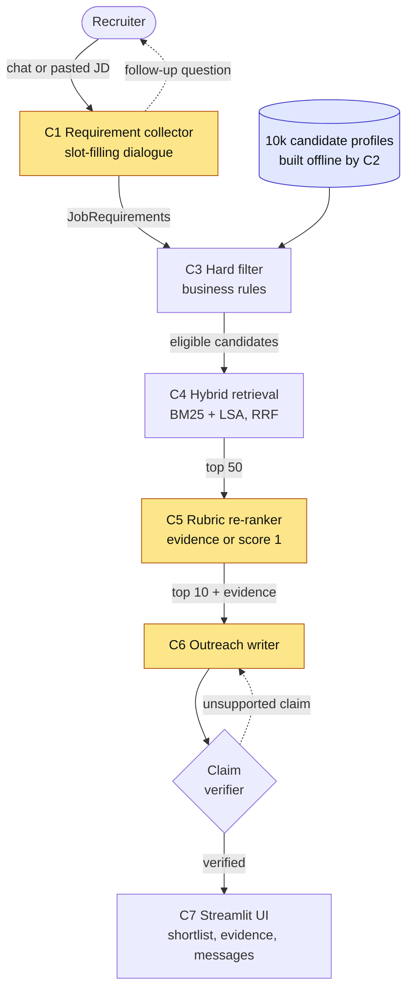

# Recruiter Assistant: NLP Assignment 1

A recruiter describes an open role in a chat. The assistant asks follow-up questions until the requirements are complete, then searches **10,000 real, anonymised IT candidate profiles**:
1. it removes candidates who break hard business rules;
2. it ranks the rest with hybrid search and an **interview-evaluation rubric that cites CV evidence**;
3. it writes a **personal LinkedIn message** for each top candidate, with every claim checked against that candidate's CV.

Every component has its own evaluation with a baseline. The system runs fully offline (rule-based) and, with an OpenRouter key, uses an LLM for extraction, scoring and writing.

> Detailed reports: CRISP-DM phases [01](reports/01_business_understanding.md) · [02](reports/02_data_understanding.md) · [03](reports/03_data_preparation.md) · [04](reports/04_modeling.md) · [05](reports/05_evaluation.md) · [06](reports/06_deployment.md) · architecture [docs/architecture.md](docs/architecture.md) · eval summary [reports/eval_summary.md](reports/eval_summary.md)

---

## 1. Task and scope

**Users:** an IT recruiter (primary) and the hiring manager who reviews the shortlist.

| In scope | Out of scope |
|---|---|
| Dialogue that collects **role, must-have skills, min years, English level** (required) plus nice-to-haves, seniority and domain; or one-shot extraction from a pasted JD | Salary, scheduling, ATS integration, actually sending messages |
| Search over a pre-existing candidate DB with business rules, hybrid retrieval and a rubric | Non-English CVs |
| Grounded LinkedIn outreach for the top 3, with a claim verifier | |

**Business logic.** The rubric is adapted from interview evaluation forms (klearskill.com): each competency is rated 1–5 and backed by evidence.

| Criterion | Weight |
|---|---|
| Must-have technical skills | 35% |
| Relevant experience (years, role match) | 25% |
| Seniority fit (over-qualification capped) | 10% |
| Nice-to-have skills / domain | 10% |
| English level | 10% |
| Motivation (candidate's "Looking For" vs the job) | 10% |

Rules:
- **No evidence quote → score 1.** LLM quotes are string-checked against the CV.
- **Failing a must-have removes the candidate** (hard filter). If fewer than 10 survive, must-have coverage is relaxed to 75%, then 50%, and the recruiter is told.
- **Junior jobs exclude senior and lead candidates** (over-qualified).
- Final order = 0.1 × rubric + 0.9 × retrieval score, normalised per search. α was tuned on training data (§5); the rubric supplies the explanation.
- Gender, age and nationality are redacted before the LLM scorer and never used.

## 2. Data (existing datasets checked before considering synthetic data)

| Dataset | Licence | Size | Use |
|---|---|---|---|
| [Djinni candidate profiles (EN)](https://huggingface.co/datasets/lang-uk/recruitment-dataset-candidate-profiles-english) | MIT | 210,250 → stratified sample of **10,000** (≥ 60 per role) | candidate database |
| [Djinni job descriptions (EN)](https://huggingface.co/datasets/lang-uk/recruitment-dataset-job-descriptions-english) | MIT | 141,897 | realistic inputs; form fields are gold for C1 |
| [resume-job-description-fit](https://huggingface.co/datasets/cnamuangtoun/resume-job-description-fit) | not stated: eval only | 6,241 train / 1,759 test pairs, labels No/Potential/Good Fit | eval for C3, C4, C5 (71 test JDs = graded queries) |
| [Annotated NER PDF Resumes (Mehyaar)](https://huggingface.co/datasets/Mehyaar/Annotated_NER_PDF_Resumes) | MIT | 5,029 CVs | skill-extraction eval for C2 |
| Hand-written dialogues (own): [dev](data/eval/c1_dialogues.jsonl), [held-out](data/eval/c1_dialogues_heldout.jsonl) | — | 30 dev + 20 held-out | eval for C1 |
| [Manually labelled Djinni pairs](data/eval/labeling_sheet.csv) (own) | — | 45 candidate–job pairs, 10 jobs | in-domain check for C3, C5, C6 |

All four open datasets are downloaded by `python scripts/download_data.py` into `data/raw/` (not committed).

The main findings from profiling (the `data-understanding` skill) and how they shaped preparation:
- `Looking For` is empty in 51% of profiles.
- Years are capped at 11, which means "10+".
- fit_labels test resumes overlap the train resumes (476 of 477), so thresholds are tuned on train and reported on test.
- The NER gold is mostly noise: only 2% of its labels are real tech skills.

## 3. System components


**Yellow** = step with an LLM version (OpenRouter); each also has a rule-based version that runs offline and is its fallback and evaluation baseline. **Blue** = data store. Dashed arrows = loops. The full diagram, including the offline data preparation (C2), is in [docs/architecture.md](docs/architecture.md).

| # | Purpose | Input → Output | Model calls | Tools |
|---|---|---|---|---|
| C1 | Collect requirements; ask for the first missing required slot. A pasted JD is extracted in one shot (role from the title, ≤ 6 must-haves) | chat turns or JD → `JobRequirements` | LLM slot extraction (JSON, pydantic-validated, 1 retry) | — |
| C2 | Structured profile from a CV | Djinni row / free text → `CandidateProfile` (skills, years, seniority, English, domains) | optional LLM skill extraction | — |
| C3 | Remove ineligible candidates (role, must-haves, years, English, over-qualified for junior jobs), with a reason for each | requirements + profiles → eligible pool | none | — |
| C4 | Rank the eligible pool by relevance | requirements → top-50 | none | rank_bm25, scikit-learn (TF-IDF + SVD) |
| C5 | Explainable ranking | requirements + top-50 → top-10 with per-criterion scores and evidence | LLM-as-scorer on the top 10 (temperature 0) | — |
| C6 | Grounded LinkedIn message | profile + requirements + evidence → message + verified claims | LLM writer (temperature 0.7) | — |
| C7 | Interface and trace | — | — | Streamlit |

**Why this is not vanilla RAG.** Retrieval (C4) is one stage between a slot-filling dialogue (C1), deterministic eligibility rules applied *before* retrieval (C3), a weighted, evidence-backed rubric (C5), and a claim verifier that rejects unsupported statements (C6).

### Walkthrough: one input through the system
1. *"We're hiring a senior Java developer for a fintech product."* C1 fills role = Java, seniority = senior, domain = fintech, and asks for must-haves.
2. *"Spring, Kafka and PostgreSQL. Kubernetes is a plus."* The clause-level cue "is a plus" makes Kubernetes a nice-to-have. C1 then asks for years ("5 years") and English ("upper-intermediate"). All slots are filled.
3. **C3** checks all 10,000 profiles: related role, all must-haves present, ≥ 5 years, English ≥ upper (and, for junior jobs, not senior/lead). 12 remain; rejection counts per rule appear in the trace.
4. **C4** runs BM25 and LSA over the eligible pool only, fuses them with RRF, and keeps up to 50.
5. **C5**: the rules score every retrieved candidate on the six criteria, each with a CV quote; the scores are blended with retrieval and sorted. In LLM mode the top 10 are re-scored by the LLM, and every quote is verified.
6. **C6** writes a message for each of the top 3: title, years, matched skills, a verbatim CV quote and the candidate's "Looking For". The verifier checks every candidate claim against the CV and every job claim against the requirements.
7. **C7** shows the stage trace (counts and timings), the shortlist with evidence, and each message with a ✅ / ⚠️ badge.

## 4. How CRISP-DM was applied

| Phase | Output | What happened |
|---|---|---|
| 1 Business Understanding | [01](reports/01_business_understanding.md) | users, scope, rubric, success criteria per component |
| 2 Data Understanding | [02](reports/02_data_understanding.md), [profiles](reports/data_profiles/) | scripted profiling of 4 datasets; quality issues, leakage and bias risks |
| 3 Data Preparation | [03](reports/03_data_preparation.md) | cleaning, stratified sampling, profile schema, index |
| 4 Modeling | [04](reports/04_modeling.md) | component choices and alternatives tried |
| 5 Evaluation | [05](reports/05_evaluation.md) | metrics vs baselines, error analysis, go / no-go |
| 6 Deployment | [06](reports/06_deployment.md) | run instructions, demo scenarios, monitoring |

The cycle was not linear. Eleven evaluation findings sent the work back to earlier phases, and each is logged with its metric effect in the **Iterations** table of [05](reports/05_evaluation.md#iterations-loops-from-evaluation-back-to-earlier-phases). Examples:
- **filter too strict** (4 of 10,000 kept) → relaxation ladder;
- **dialogue rules over-fitted** → a held-out set was written;
- **rubric ≈ random** on out-of-domain data → blend with retrieval (α tuned on train);
- **free-tier quota** → the LLM scores only the top 10;
- **manual labels** exposed a role misparse, bloated must-haves, awkward messages and leads shortlisted for a junior job → four fixes plus a junior-job rule; top-3 precision on the labels is now 0.90.

## 5. Evaluation results (rule-based mode)

| Component | Metric | System | Baseline |
|---|---|---|---|
| C1 | completion rate / must-have F1 (**held-out** dialogues) | 0.90 / 0.929 | dev set: 1.0 / 0.965 |
| C1 | role accuracy, one-shot on 200 Djinni JDs | 0.675 | 0.125 (majority) |
| C2 | P / R / F1 on tech skills (500 CVs) | 0.948 / 0.720 / 0.819 | gazetteer 0.998 / 0.827 / 0.904 |
| C3 | fit_labels: Good-Fit recall / No-Fit removed / precision of kept (strict) | 0.114 / 0.837 / 0.530 | no filter: 1 / 0 / 0.513 |
| C3 | manual labels: labelled candidates the system rejects | 8, all labelled No Fit | — |
| C4 | nDCG@10 / MRR / Recall@50 | 0.096 / 0.219 / 0.285 | BM25 0.089 / 0.192 / 0.263; random 0.031 / 0.117 / 0.146 |
| C5 | fit_labels in-pool nDCG@10: final blend / rubric only | **0.689** / 0.563 | hybrid 0.682; random 0.568 |
| C5 | fit_labels 3-class macro-F1 | 0.344 | 0.218 (majority) |
| C5 | **manual labels (45 Djinni pairs, 10 jobs): top-3 precision** (Good or Potential) / #1 is Good | **0.90** / 7 of 10 | — |
| C5 | manual labels, same 30 pairs: Spearman final (all / only retrieved) | 0.424 / 0.069 | before fixes: 0.141 |
| C6 | faithful messages / CTA / length in range (59 messages) | 1.0 / 1.0 / 1.0 | — |
| C6 | verifier recall: fake skill / years / quote / domain (FP rate) | 1.0 / 0.88 / 1.0 / 1.0 (0.0) | — |
| C6 | manual message score (1–5) | 3.0 | first template: 2.8 |

**What's high and what's low, and why** (full analysis in [05](reports/05_evaluation.md)):
- **High:** dialogue slot filling; skill precision; message faithfulness; the verifier.
- **C2 "all gold" F1 = 0.03 is a gold-quality finding.** 98% of the NER labels are words like `com` and `gmail`. On real tech skills the extractor reaches F1 0.82.
- **C3 and C5 are weak on fit_labels, which is out of domain.** Those resumes have no form fields or "Looking For", so most rubric criteria get "no evidence → 1" (English 98%, motivation 100%). The blend with retrieval recovers the ranking (0.689, best of all methods).
- **In domain, on manually labelled Djinni candidates, the shortlist is mostly right:** 27 of the 30 top-3 candidates are worth contacting, and every labelled candidate the filter rejects was labelled No Fit. The first labelling round found the weak spots (a role misparse, bloated must-haves, awkward messages, leads shortlisted for a junior job); fixing them raised agreement on the same 30 pairs from 0.141 to 0.424. That gain comes from the filter (it now rejects only No-Fit candidates); the order among surviving candidates still barely tracks the labels (0.069), which is what the LLM scorer should improve. The remaining misses are a role the pool barely covers (Head of Payment) and support roles where only customer-support profiles surface.
- **Messages are faithful but only average (3.0/5):** correct, but template-like.
- **C4's absolute values are lower bounds**, because unjudged pairs count as non-relevant. Hybrid is about 3× random.
- **LLM variants are implemented but not evaluated.** The OpenRouter free tier allows 50 requests/day, and the evals need several hundred. The eval code runs them automatically when quota allows; the labelled sheet then also gives the judge-vs-label agreement.

## 6. How the coding agent was managed

| Mechanism | File | What it controls |
|---|---|---|
| Project instructions, loaded every session | [CLAUDE.md](CLAUDE.md) | architecture table and I/O contracts, data rules (sampling, seed, privacy), rubric weights, LLM rules (prompts in files, validation, cache, logging, temperatures), **evaluation rules (a baseline for every metric, never invent numbers, tune on train only)**, CRISP-DM phase → report mapping, code conventions, git policy, definition of done, when to ask first |
| Skill: `data-understanding` | [.claude/skills/data-understanding/](.claude/skills/data-understanding/) | scripted dataset profiling → phase-2 report; never print full CVs |
| Skill: `run-evals` | [.claude/skills/run-evals/](.claude/skills/run-evals/) | run evals, interpret high vs low, log iterations, never tune on test |
| Skill: `crisp-dm-report` | [.claude/skills/crisp-dm-report/](.claude/skills/crisp-dm-report/) | keep phase reports and Iterations tables in sync |
| Guard rails in code | `config.py`, `schemas.py`, `prompts/`, `tests/` | weights in one place, pydantic contracts, prompts outside code, 18 unit tests on the business rules |

**Reflection.** The instructions file mattered most for the decisions the agent must *not* take alone. CLAUDE.md §13 made it stop and ask before changing the scoring formula (the blend), the dataset list (TalentCLEF → fit_labels), the model, or a business rule (the junior-job filter). The evaluation rules made it write a held-out set once it noticed it had tuned the dialogue rules on the dev set. The skills turned repeated multi-step work (profiling, evals, report upkeep) into one command with fixed rules, which kept the reports consistent with the numbers.

## 7. Run it

Requires Python 3.11+ (developed on 3.12).

```bash
pip install -r requirements.txt
cp .env.example .env              # optional: OPENROUTER_API_KEY=... for LLM mode
python scripts/download_data.py   # ~1 GB into data/raw/ (git-ignored)
python scripts/prepare_data.py    # 10k sample + profiles + index (~5 min)
streamlit run app.py              # the app, at http://localhost:8501
python scripts/rescore_labeling_sheet.py  # re-score the labelled pairs with the current code
python eval/run_all.py            # all evals -> reports/eval_summary.md (~12 min)
pytest -q && ruff check . && ruff format --check .
```
- Offline mode: leave the key empty, or run `OPENROUTER_API_KEY= streamlit run app.py`.
- LLM mode: set `LLM_MODEL` / `JUDGE_MODEL` in `.env` (defaults: `baidu/ernie-5.5-flash-preview:free` / `nvidia/nemotron-3.5-super-vl:free`).
- About 17 LLM calls per search. Failed calls fall back to rules, and the sidebar shows a warning.

## 8. Repository

```
app.py                      Streamlit UI (C7)
src/recruiter/              c1_requirements · c2_profiles · c3_filter · c4_retrieval · c5_reranker · c6_outreach
                            pipeline · lexicon · schemas · config · llm · prompts/*.md
scripts/                    download_data.py · prepare_data.py · make_labeling_sheet.py · rescore_labeling_sheet.py
eval/                       eval_c1…c6, eval_human_agreement, run_all, rubrics/
data/eval/                  hand-made gold sets (dialogues; labelling sheet with 45 labelled pairs)
reports/                    CRISP-DM phases 01–06, eval/ (json + md per component), data_profiles/
docs/                       architecture.md, assignment
.claude/skills/             data-understanding · run-evals · crisp-dm-report
```

## 9. Limitations
- The LLM path is implemented and smoke-tested but not evaluated against the real model (free-tier quota). LSA replaces neural embeddings (environment constraint).
- fit_labels is out of domain for the Djinni-tuned rubric; the in-domain labelled sample is small (45 pairs, 10 jobs).
- One-shot extraction from pasted JDs is weaker than the dialogue (role accuracy 0.675 vs 0.95 on held-out dialogues).
- The system can only rank who is in the 10k pool: roles it barely covers (e.g. payments leadership) get weak shortlists.
- Candidate data is 2021–2023 and anonymised, so messages start with "Hi there,".
