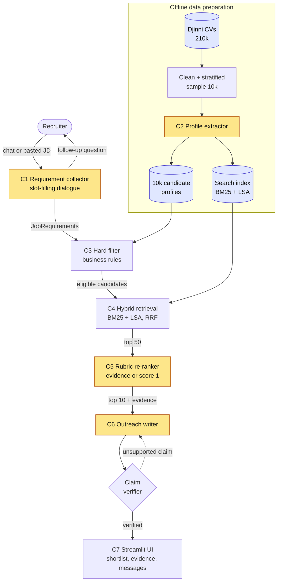

# Architecture: Recruiter Assistant

## Data flow

**Yellow** = step with an LLM version (OpenRouter, OpenAI-compatible); each has a rule-based version that runs offline and is also its fallback and evaluation baseline. **Blue** = data stores. Dashed arrows = loops: the collector asks again until the required slots are filled, and an LLM message with an unsupported claim is regenerated once, then replaced by the template. C5's LLM step re-scores only the top 10; the final order is 0.1 × rubric + 0.9 × retrieval. Without `OPENROUTER_API_KEY` the whole system runs offline.

## Components

| # | Purpose | Input → Output | Model calls | External tools | Eval (metric) |
|---|---|---|---|---|---|
| C1 | Collect job requirements by dialogue; ask follow-ups until the required slots (role, must-haves, min years, English) are filled. A pasted JD is extracted in one shot (role from the title, ≤ 6 must-haves from requirement sections) | chat text or JD → `JobRequirements` | LLM slot extraction (JSON, validated, 1 retry) | — | slot accuracy, skill P/R/F1, completion rate, extra turns (hand-made dev + held-out dialogues); role/years/English accuracy on 200 Djinni JDs |
| C2 | Turn a raw CV into a structured profile | Djinni row or free text → `CandidateProfile` | optional LLM skill extraction | — | skill P/R/F1 vs Mehyaar NER gold; years/English from text vs form fields |
| C3 | Remove candidates who break hard business rules (and say why): role, must-haves, years, English, over-qualified for junior jobs | requirements + profiles → eligible pool + reasons | none (deterministic) | — | Good-Fit recall, No-Fit removal, precision of kept vs no-filter baseline (fit_labels); labels of rejected candidates (manual labels) |
| C4 | Find the most relevant eligible candidates | requirements → top-50 ids | none (BM25 + LSA, RRF) | — | nDCG@10, MRR, Recall@50 vs BM25-only, dense-only, random |
| C5 | Explainable ranking with an interview-style rubric | requirements + top-50 profiles → ranked list, per-criterion score, evidence, rationale | LLM-as-scorer (temperature 0), **top 10 only**; rules score all 50 | — | in-pool nDCG@10, Spearman, macro-F1 vs fit labels; per-criterion signal; top-3 precision on manual Djinni labels |
| C6 | Personal LinkedIn message grounded in the CV | profile + requirements + rubric evidence → message + verified claims | LLM writer (temperature 0.7) | — | faithfulness, personalisation, length, CTA, diversity; verifier recall under hallucination injection; LLM judge |
| C7 | Interface and trace for the recruiter | — | — | Streamlit | manual demo scenarios (reports/06) |

## Walkthrough: one input through the system

Recruiter: *"We're hiring a senior Java developer for a fintech product."*
1. **C1** extracts `role=Java`, `seniority=senior`, `domain=fintech`. "Java" is held as a *pending* skill, because naming the role is not yet a list of must-haves. `must_have_skills` is still missing, so C1 asks for the must-haves. The recruiter replies *"Spring, Kafka and PostgreSQL. Kubernetes is a plus."*: the clause-level cue "is a plus" puts Kubernetes under nice-to-have. C1 then asks for years ("5 years") and English ("upper-intermediate"). All four slots are filled.
2. **C3** checks all 10,000 profiles: role ∈ {Java}, must-haves {Java, Spring, Kafka, PostgreSQL} ⊆ skills, years ≥ 5, English ≥ upper (for a junior job it would also drop senior and lead profiles). 12 survive; survivors and rejection counts per rule go to the trace. If fewer than 10 survive, must-have coverage is relaxed to 75%, then 50%, and the UI warns the recruiter.
3. **C4** searches only the eligible ids with the query built from the requirements (title, role, must-haves twice, nice-to-haves, domain). BM25 and LSA rankings are fused with RRF (k = 60), keeping the top 50.
4. **C5** scores each of the 50 with the rule scorer on six criteria, each 1–5 with an evidence quote: must-haves 35%, experience 25%, seniority 10%, nice-to-have/domain 10%, English 10%, motivation ("Looking For" vs the job) 10%. A missing quote scores 1, and an over-qualified lead is capped for a junior job. The final order blends the normalised rubric total (10%) with the retrieval score (90%). In LLM mode the LLM then re-scores only the top 10 (verifying every quote), and those 10 are re-blended among themselves. A search therefore costs about 17 LLM calls: about 4 for C1, 10 for C5 and 3 for C6.
5. **C6** writes a message for each of the top 3: CV title, years, matched skills, one verbatim CV quote, and a link to the candidate's "Looking For" (only a sentence that states a goal: restrictions like "No gambling" and list headers are skipped). The verifier then checks every claim. Skills in "you/your" sentences must be in the CV, year counts must match the profile, quotes must appear verbatim, and job claims must be in the requirements.
6. **C7** shows the stage trace (counts and timings per stage), the shortlist with per-criterion scores and evidence, and the messages with a ✅ or ⚠️ verification badge.

## Configuration and contracts

- Rubric weights, filter thresholds, top-N/K and LLM settings live in `src/recruiter/config.py` only.
- Every boundary is a pydantic model in `src/recruiter/schemas.py`.
- Prompts are in `src/recruiter/prompts/*.md`. LLM calls are cached in `data/processed/llm_cache/` and logged to `data/processed/logs/llm_calls.jsonl` (component, model, tokens, latency).
